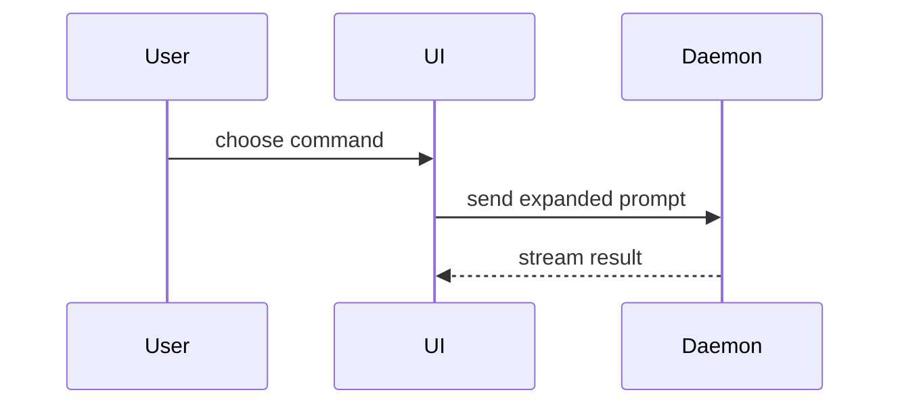

## Workflow

1. Read the diff: `git diff origin/main...HEAD`. It is a **UI change** when it alters what a user sees: a `.svelte` file's markup or styles, `src/app.css`, or copy.
2. Fill in the [template](#template), section by section.
3. For a UI change, capture and lay out screenshots per [SCREENSHOTS.md](SCREENSHOTS.md).
4. Write the body to `/tmp/<branch>/body.md`, outside the repo.
5. Post it. With no images: `gh pr create --title "..." --body-file /tmp/<branch>/body.md` (or `gh pr edit <N> --body-file ...`). With images: upload per [SCREENSHOTS.md](SCREENSHOTS.md#upload).
6. Check the posted body: `gh pr view <N> --json body -q .body` renders every view and image, and holds no `/tmp/` paths. Fix and re-post until it does.

## Template

```markdown
## Summary

<one or two sentences, then a view only if the change is hard to follow from prose>

## Evidence

- **Before:** <screenshot/output/failing test run>
  **After:** <screenshot/output/passing test run>

## Merge Danger

**Door:** <one-way or two-way>

<optional: description>

**Blast Radius:** <one-word description>

<optional: potential ramifications of merge>
```

## Sections

Keep prose brief and open each section with its point. Use the domain language in `CONTEXT.md`.

### Summary

Start with prose. Add a view only when the shape of the change is hard to follow from the words alone, then pick the smallest view that makes the key point clear. Many PRs need none.

- Show logic or an algorithm as pseudocode:

```text
on(save)
  if content is unchanged
    return cached result
  write new content
  return fresh result
```

- Show runtime control flow as a call tree:

```text
submitForm
  createSession
    persistPrompt
    launchAgent
  navigateToSession
```

- Show UI structure as a component tree, including state and module boundaries that matter:

```text
<SessionPage> (apps/example/src/routes/session.tsx)
  useSessionEvents()
  <SessionToolbar>
    <RunSkillButton> (packages/ui)
```

- Show file responsibility or a broad refactor as a shallow file tree:

```text
src/
├── commands/       # parses user actions
├── sessions/       # owns session state
└── transport/      # sends API requests
```

- Show component interaction, control flow, or data flow with Mermaid:



- Use `diff` when the point is what changes and the surrounding shape already exists. Match the diff shape to the topic.

For a component change:

```diff
 <SessionPage>
   useSessionEvents()
   <SessionToolbar>
+    <RunSkillButton />
   <SessionTimeline>
+    <SkillResultCard />
```

For a file-layout change:

```diff
 src/
 ├── commands/
+│   └── show-me.ts       # expands the slash command
 ├── sessions/
-└── transport.ts
+└── transport/
+    ├── client.ts
+    └── stream.ts
```

For a call-tree or call-stack change:

```diff
 submitForm
   createSession
     persistPrompt
+    expandSkillMention
     launchAgent
-  navigateToSession
+  navigateToSession
+    subscribeToEvents
```

For a state or control-flow change:

```diff
 on(save)
-  write content
+  if content is unchanged
+    return cached result
+  write new content
+  invalidate cache
```

- Show the whole block when most of it is new, when omitted context would hide ownership or order, or when the user needs a copyable target shape:

```ts
function expandSkill(command: string): string {
	const skillName = command.slice(1);
	return `use the ${skillName} skill`;
}
```

Place each view next to the short text it supports. Keep only the calls, files, props, states, and boundaries needed to understand the change. One or two views usually suffice.

### Evidence

Concrete evidence that the change works. Show a before and after.

- **UI change:** screenshots of each changed screen, before and after, in light and dark mode, per [SCREENSHOTS.md](SCREENSHOTS.md).
- **Other changes:** the exact test that failed before and passes after, as pseudocode, with the command output.

### Merge Danger

Describe whether it's a one-way or two-way door. You can walk back through two-way doors, but not one-way doors. A PR that is cheap to roll back is lower risk. Changes that involve destructive actions or hard-to-reverse decisions (a stored data shape, a `localStorage` key, a deleted file users depend on) are one-way doors.

The blast radius is the potential impact or scope of the changes introduced by this PR. Consider all possibilities. Examples are layout shift, breakages for consumers, mobile responsiveness, etc.
