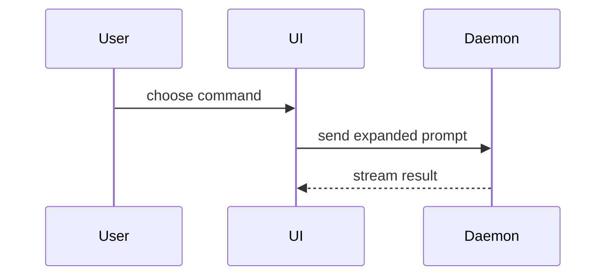

Use this template for writing the PR body:

```markdown
## Summary

<one or two sentences, then a diagram, diff-sketch, or tree only if the change is hard to follow from prose>

## Evidence

- **Before:** <screenshot/output/failing test run>
  **After:** <screenshot/output/passing test run>

## Merge Danger

**Door:** <one-way or two-way>

<optional: description>

**Blast Radius:** <one-word description>

<optional: potential ramifications of merge>
```

## Sections

Skip all preambles and keep prose brief. Use the domain language in `CONTEXT.md`.

### Summary

Start with prose. Add a visual only when the shape of the change is hard to follow from the words alone, and then pick the smallest view that makes the key point clear. Many PRs need none.

- Show logic or an algorithm as pseudocode:

```text
on(save)
  if content is unchanged
    return cached result
  write new content
  return fresh result
```

- Show runtime control flow as a call tree:

```text
submitForm
  createSession
    persistPrompt
    launchAgent
  navigateToSession
```

- Show UI structure as a component tree, including state and module boundaries that matter:

```text
<SessionPage> (apps/example/src/routes/session.tsx)
  useSessionEvents()
  <SessionToolbar>
    <RunSkillButton> (packages/ui)
```

- Show file responsibility or a broad refactor as a shallow file tree:

```text
src/
├── commands/       # parses user actions
├── sessions/       # owns session state
└── transport/      # sends API requests
```

- Show component interaction, control flow, or data flow with Mermaid:



- Use `diff` when the point is what changes and the surrounding shape already exists. Match the diff shape to the topic.

For a component change:

```diff
 <SessionPage>
   useSessionEvents()
   <SessionToolbar>
+    <RunSkillButton />
   <SessionTimeline>
+    <SkillResultCard />
```

For a file-layout change:

```diff
 src/
 ├── commands/
+│   └── show-me.ts       # expands the slash command
 ├── sessions/
-└── transport.ts
+└── transport/
+    ├── client.ts
+    └── stream.ts
```

For a call-tree or call-stack change:

```diff
 submitForm
   createSession
     persistPrompt
+    expandSkillMention
     launchAgent
-  navigateToSession
+  navigateToSession
+    subscribeToEvents
```

For a state or control-flow change:

```diff
 on(save)
-  write content
+  if content is unchanged
+    return cached result
+  write new content
+  invalidate cache
```

- Show the whole block when most of it is new, when omitted context would hide ownership or order, or when the user needs a copyable target shape:

```ts
function expandSkill(command: string): string {
	const skillName = command.slice(1);
	return `use the ${skillName} skill`;
}
```

Place each visual next to the short text it supports. Keep only the calls, files, props, states, and boundaries needed to answer the question the change raises. One or two views usually suffice, and a diagram is never required.

### Evidence

Concrete evidence that the change works. Show a before and after.

Screenshots are S-tier when the change is visual. Execution-based evidence is A-tier: test results, console output. Show the exact test that now fails and passes, using pseudocode.

#### UI change: screenshots

Every UI change gets screenshots of each changed screen, before and after, in light and dark mode. Capture them to `/tmp/<branch>/`, outside the repo.

1. Serve the change: `npm run dev -- --port 5173`.
2. Serve the base in a worktree:

   ```shell
   git worktree add /tmp/<branch>/base origin/main
   ln -s "$PWD/node_modules" /tmp/<branch>/base/node_modules
   (cd /tmp/<branch>/base && npx vite dev --port 5174)
   ```

3. Run the capture script once per screen and side:

   ```shell
   node .agents/skills/pr/screenshot.mjs http://localhost:5174/<path> /tmp/<branch> before-<screen>
   node .agents/skills/pr/screenshot.mjs http://localhost:5173/<path> /tmp/<branch> after-<screen>
   ```

   Each run writes `<name>-light.png` and `<name>-dark.png`. If launch fails with `Executable doesn't exist`, run `npx playwright install chromium`, or set `CHROMIUM_PATH` to a Chromium already on the machine. A screen that needs state (an uploaded class, an open dialog) needs a Playwright script that drives the page there before capturing; reuse `screenshot.mjs` as its starting point.

4. Open each PNG and confirm it shows the changed screen, not an error page or an empty state.
5. Lay them out as a table:

   ```markdown
   |        | Before                                | After                                |
   | ------ | ------------------------------------- | ------------------------------------ |
   | Light  |  |  |
   | Dark   |    |    |
   ```

   The alt text in each reference is what GitHub keeps.

6. Remove the worktree: `git worktree remove /tmp/<branch>/base`.

A brand-new screen has no before; show the after alone. If capture fails, write under Evidence which screen is missing and the error, and fall back to test runs.

#### Other changes: test runs

Show the exact test that failed before and passes after, as pseudocode, with the command output.

### Merge Danger

Describe whether it's a one-way or two-way door. You can walk back through two-way doors, but not one-way doors. A PR that is cheap to roll back is lower risk. Changes that involve destructive actions or hard-to-reverse decisions (a stored data shape, a `localStorage` key, a deleted file users depend on) are one-way doors.

The blast radius is the potential impact or scope of the changes introduced by this PR. Consider all possibilities. Examples are layout shift, breakages for consumers, mobile responsiveness, etc.

### Posting

Write the body to `/tmp/<branch>/body.md`, outside the repo. With no images, post it with `gh pr create --title "..." --body-file /tmp/<branch>/body.md` (or `gh pr edit <N> --body-file ...`).

With images, `gh` uploads them with `--attach`, which needs push access to the repo and a `gh` whose `gh pr create --help` lists `--attach`; upgrade `gh` if it doesn't.

1. Reference each image in the body by the exact path you will pass to `--attach` (the screenshot table above does this). `gh` replaces each referenced path with the uploaded URL in place.
2. Post with one `--attach` per file:

   ```shell
   gh pr create --title "..." --body-file /tmp/<branch>/body.md \
     --attach /tmp/<branch>/before-x-light.png \
     --attach /tmp/<branch>/after-x-light.png \
     --attach /tmp/<branch>/before-x-dark.png \
     --attach /tmp/<branch>/after-x-dark.png
   ```

   To update an existing PR, use `gh pr edit <N> --body-file /tmp/<branch>/body.md` with the same `--attach` flags.

3. Check: `gh pr view <N> --json body -q .body | grep /tmp/` prints nothing. An attached file the body never references is appended to the end of the body, so an image at the bottom means a path in the body is misspelt: fix the path and re-run `gh pr edit` with every `--attach`.

Only images and videos upload, and each file attaches once per command. For a video, put `` alone in its own paragraph to get a player.
