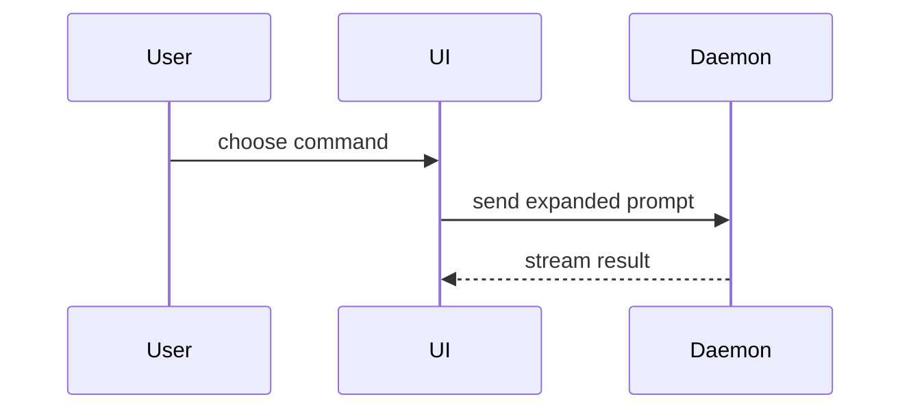
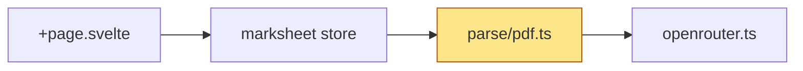

## Workflow

Copy this checklist into your response and tick it off:

```
PR body:
- [ ] 1. Read the diff and classify it (UI or not)
- [ ] 2. Summary: at least one diagram
- [ ] 3. Evidence: screenshots for UI, test runs otherwise
- [ ] 4. Merge Danger
- [ ] 5. Check the body against the done list
- [ ] 6. Post it
```

1. **Read the diff**: `git diff origin/main...HEAD --stat`, then the diff itself. The change is a **UI change** when it alters anything a user sees: a `.svelte` file's markup or styles, `src/app.css`, or copy. A change to a `.svelte` file's script alone is a UI change when it changes what renders.
2. **Summary**: write it per [Summary](#summary).
3. **Evidence**: write it per [Evidence](#evidence).
4. **Merge Danger**: write it per [Merge Danger](#merge-danger).
5. **Check** the body:
   - The Summary holds at least one diagram, and every Mermaid block parses (no labels with unquoted `()`, `[]` or `:`).
   - A UI change has before and after screenshots in light and dark mode, or Evidence says which capture failed and why.
   - Terms match `CONTEXT.md`.
6. **Post** with the [`upload-screenshots`](../upload-screenshots/SKILL.md) skill when the body references images; otherwise create the PR with the body as written.

Done when the PR's body on GitHub renders every diagram and image, and contains no `/tmp/` paths.

## Template

Use this template for the PR body:

```markdown
## Summary

<one or two sentences, then the diagram(s)>

## Evidence

**Before:** <screenshot/output/failing test run>
**After:** <screenshot/output/passing test run>

## Merge Danger

**Door:** <one-way or two-way>

<optional: description>

**Blast Radius:** <one-word description>

<optional: potential ramifications of merge>
```

Skip all preambles and keep prose brief. Use the domain language in `CONTEXT.md`.

## Summary

Every Summary has at least one diagram showing how the changed code fits together. Default to a Mermaid diagram: GitHub renders it, and it shows flow between modules better than prose. Use a text view (tree, diff, pseudocode) when the point is shape rather than flow. Pick the smallest set of views that makes the change clear.

- Show component interaction, control flow, or data flow with Mermaid:



- Show module dependencies or state transitions with a Mermaid `flowchart` or `stateDiagram-v2`. Mark what the PR adds or changes with a class:



- Show logic or an algorithm as pseudocode:

```text
on(save)
  if content is unchanged
    return cached result
  write new content
  return fresh result
```

- Show runtime control flow as a call tree:

```text
submitForm
  createSession
    persistPrompt
    launchAgent
  navigateToSession
```

- Show UI structure as a component tree, including state and module boundaries that matter:

```text
<SessionPage> (apps/example/src/routes/session.tsx)
  useSessionEvents()
  <SessionToolbar>
    <RunSkillButton> (packages/ui)
```

- Show file responsibility or a broad refactor as a shallow file tree:

```text
src/
├── commands/       # parses user actions
├── sessions/       # owns session state
└── transport/      # sends API requests
```

- Use `diff` when the point is what changes and the surrounding shape already exists. Match the diff shape to the topic.

For a component change:

```diff
 <SessionPage>
   useSessionEvents()
   <SessionToolbar>
+    <RunSkillButton />
   <SessionTimeline>
+    <SkillResultCard />
```

For a file-layout change:

```diff
 src/
 ├── commands/
+│   └── show-me.ts       # expands the slash command
 ├── sessions/
-└── transport.ts
+└── transport/
+    ├── client.ts
+    └── stream.ts
```

For a call-tree or call-stack change:

```diff
 submitForm
   createSession
     persistPrompt
+    expandSkillMention
     launchAgent
-  navigateToSession
+  navigateToSession
+    subscribeToEvents
```

For a state or control-flow change:

```diff
 on(save)
-  write content
+  if content is unchanged
+    return cached result
+  write new content
+  invalidate cache
```

- Show the whole block when most of it is new, when omitted context would hide ownership or order, or when the user needs a copyable target shape:

```ts
function expandSkill(command: string): string {
	const skillName = command.slice(1);
	return `use the ${skillName} skill`;
}
```

Place each visual next to the short text it supports. Keep only the calls, files, props, states, and boundaries needed to understand the change. One or two views usually suffice.

## Evidence

Concrete evidence that the change works, as a before and after.

### UI change: screenshots

Every UI change gets screenshots of each changed screen, before and after, in light and dark mode. Capture them to `/tmp/<branch>/`, outside the repo.

1. Serve the change: `npm run dev -- --port 5173`.
2. Serve the base in a worktree:

   ```shell
   git worktree add /tmp/<branch>/base origin/main
   ln -s "$PWD/node_modules" /tmp/<branch>/base/node_modules
   (cd /tmp/<branch>/base && npx vite dev --port 5174)
   ```

3. Run the capture script once per screen and side:

   ```shell
   node .agents/skills/pr/screenshot.mjs http://localhost:5174/<path> /tmp/<branch> before-<screen>
   node .agents/skills/pr/screenshot.mjs http://localhost:5173/<path> /tmp/<branch> after-<screen>
   ```

   Each run writes `<name>-light.png` and `<name>-dark.png`. If launch fails with `Executable doesn't exist`, run `npx playwright install chromium`, or set `CHROMIUM_PATH` to a Chromium already on the machine. A screen that needs state (an uploaded class, an open dialog) needs a Playwright script that drives the page there before capturing; reuse `screenshot.mjs` as its starting point.

4. Open each PNG and confirm it shows the changed screen, not an error page or an empty state.
5. Lay them out as a table:

   ```markdown
   |        | Before                                | After                                |
   | ------ | ------------------------------------- | ------------------------------------ |
   | Light  |  |  |
   | Dark   |   |   |
   ```

6. Remove the worktree: `git worktree remove /tmp/<branch>/base`.

A brand-new screen has no before; show the after alone. If capture fails, write under Evidence which screen is missing and the error, and fall back to test runs.

### Other changes: test runs

Show the exact test that failed before and passes after, as pseudocode, with the command output.

## Merge Danger

Describe whether it's a one-way or two-way door. You can walk back through two-way doors, but not one-way doors. A PR that is cheap to roll back is lower risk. Changes that involve destructive actions or hard-to-reverse decisions (a stored data shape, a `localStorage` key, a deleted file users depend on) are one-way doors.

The blast radius is the potential impact or scope of the changes introduced by this PR. Consider all possibilities. Examples are layout shift, breakages for consumers, mobile responsiveness, etc.
